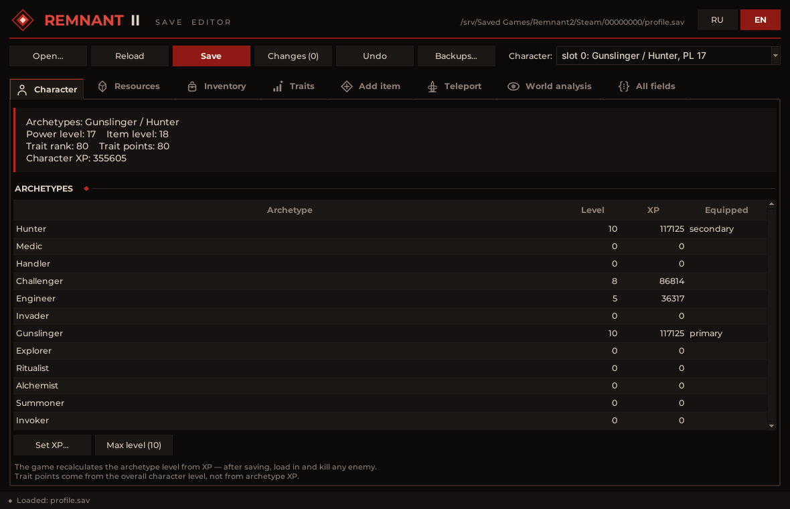
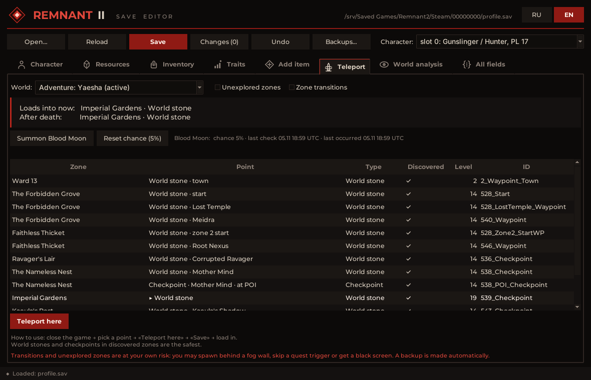
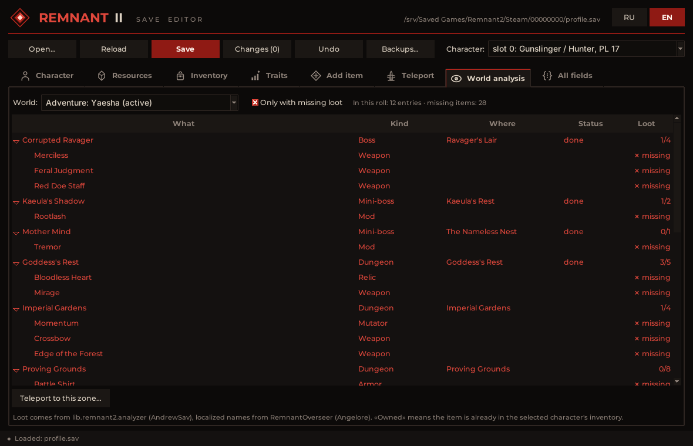
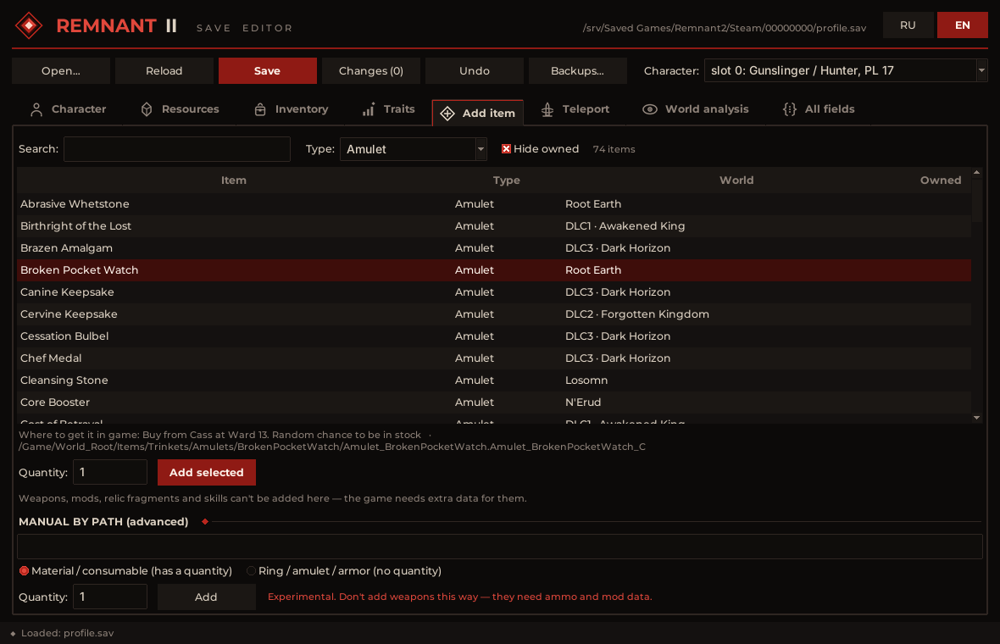

<div align="center">


# Remnant 2 Save Editor

**Analyze and edit Remnant 2 saves: resources, items, archetypes, teleport, Blood Moon, world loot.**

Pure Python · no dependencies · dark Remnant-style GUI + CLI · English / Русский



</div>

> [!WARNING]
> Unofficial fan tool. **Close the game completely before saving**, keep the automatic backups, and use it in
> solo play. Editing saves is at your own risk.

## Features

| | |
|---|---|
| **Character** | Archetype XP with a "max level" button, overview of power level, trait rank and trait points |
| **Resources** | Scrap, Lumenite, Relic Dust, irons, Blood Moon Essence, DLC alloys… Creates missing resources |
| **Inventory** | Searchable list with categories; stack quantity and upgrade level of weapons, mutators and relic fragments; **delete** rings, amulets, armor, mutators, consumables and materials (refuses anything equipped, attached to a weapon or bound to the radial menu) |
| **Quest items** | List the quest items each world keeps in `save_N.sav` (keys, coins…); duplicate Crimson King Coins |
| **Traits** | Trait levels with a live budget: points spent vs. available, a warning before you overspend and again on save |
| **Add item** | Catalog of ~700 rings, amulets, armor, relics, engrams, mutators, consumables and materials by name, with "where to get it in game" |
| **Teleport** | Pick where the game spawns you on the next load: world stones and checkpoints of the campaign or adventure, with the game's own world stone names (*World stone · Mournful Promenade*) and readable checkpoints (*Checkpoint · end*) |
| **Open world stones** | Activate a world stone (or all stones of a world) so it appears in the in-game travel menu without walking there |
| **Blood Moon** | Make the game roll a Blood Moon on the next zone load, then reset the chance afterwards |
| **World analysis** | Bosses, dungeons, events and item pickups of the current roll, their loot and what you already own; jump straight to the zone |
| **All fields** | Raw editor for any number / bool / string in `profile.sav` and `save_N.sav` |
| **Safety** | Automatic backups (the newest 20 per file are kept — configurable), a backup browser with restore, undo (Ctrl+Z), change list, protection against overwriting progress the game saved in the meantime |

<table>
<tr>
<td></td>
<td></td>
</tr>
<tr>
<td align="center">Teleport &amp; Blood Moon</td>
<td align="center">World analysis</td>
</tr>
<tr>
<td colspan="2"></td>
</tr>
<tr>
<td colspan="2" align="center">Item catalog</td>
</tr>
</table>

## Getting started

### 1. Install Python (once)

Download **Python 3.8 or newer** from [python.org](https://www.python.org/downloads/windows/) and run the installer:

- tick **Add python.exe to PATH**;
- keep **tcl/tk and IDLE** enabled (default) — the GUI needs it.

Check in a terminal (`Win + R` → `cmd`): `python --version` (or `py --version`) should print 3.8+.

### 2. Get the editor

- **Code → Download ZIP** on this page and unpack it anywhere, **or**
- `git clone https://github.com/distrix11/Remnant2Editor.git`

### 3. Run it

| Way | How |
|---|---|
| **Start Editor.bat** | Double-click. Starts the GUI without a console window. |
| `Remnant2SaveEditor.pyw` | Double-click (same thing, if `.pyw` files are associated with Python). |
| From a terminal | `cd Remnant2Editor` → `python Remnant2SaveEditor.pyw` (shows errors in the console, handy for debugging) |
| Command line tools | `python -m r2save --help` (see [Command line](#command-line)) |

The editor finds `%USERPROFILE%\Saved Games\Remnant2\Steam\<id>\profile.sav` automatically and opens the world
save `save_N.sav` of the selected character alongside. Another file: **Open…**.

### 4. Edit

1. **Close Remnant 2 completely** (not just to the main menu).
2. Make your changes. Every change can be undone (**Undo**, Ctrl+Z); **Changes (N)** lists them.
3. **Save** (Ctrl+S) — the editor shows the list, backs up the original and writes the file.
4. Start the game.

Interface language: **RU / EN** buttons in the top-right corner (English by default, the choice is remembered).

## Build a standalone .exe

A single `Remnant2SaveEditor.exe` (~14 MB) that runs **without Python** — handy to keep on the desktop or to give to
a friend. You need Python only to build it.

### One click

Double-click **`build.bat`** in the editor folder. It:

1. creates a local virtual environment `.venv` (nothing is installed system-wide);
2. installs [PyInstaller](https://pyinstaller.org) into it;
3. builds **`dist\Remnant2SaveEditor.exe`** from `Remnant2SaveEditor.spec` and opens the folder.

The first build takes 1–2 minutes (downloading PyInstaller), later ones ~30 seconds.

### Manually

```bat
cd Remnant2Editor
python -m venv .venv
.venv\Scripts\python -m pip install pyinstaller
.venv\Scripts\python -m PyInstaller --clean --noconfirm Remnant2SaveEditor.spec
```

### Notes

- The .exe bundles everything: item database, names, icons, the Montserrat font, Tcl/Tk.
- Settings (`settings.json`) and the error log (`editor.log`) of the .exe live in `%APPDATA%\Remnant2SaveEditor`.
  If something goes wrong, look at `editor.log` first.
- **Rebuild after updating the source** — the .exe does not update itself. The version is shown in the **?** (About)
  window and in the exe's *Properties → Details*; both come from `__version__` in `r2save/__init__.py`.
- Windows SmartScreen / Defender may warn about a freshly built, unsigned PyInstaller exe. That is a common false
  positive; building it yourself from this source is the safe way.
- `build\`, `dist\` and `.venv\` are ignored by git. The command line (`python -m r2save ...`) still needs Python.

<details>
<summary>Troubleshooting</summary>

| Problem | Fix |
|---|---|
| `Python 3 not found` / `'python' is not recognized` | Reinstall Python with **Add python.exe to PATH**, or run from the folder with `py -3 Remnant2SaveEditor.pyw`. |
| `No module named tkinter` | Re-run the Python installer → *Modify* → enable **tcl/tk and IDLE**. |
| The window closes immediately | Run `python Remnant2SaveEditor.pyw` from a terminal to see the error; for the .exe check `%APPDATA%\Remnant2SaveEditor\editor.log`. |
| "Remnant 2 is running" on save | Close the game completely; check Task Manager for `Remnant2-Win64-Shipping.exe`. |
| "file changed on disk" on save | The game saved after you opened the editor. Press **Reload** and redo the edits. |
| Black screen after loading in game | Kill the game in Task Manager, **Backups…** → restore the previous `save_N.sav`. Possible cause: teleporting to an undiscovered world stone. |

</details>

## Safety

- **Backups.** Every save first copies the original to `<save folder>\_editor_backups\<file>.<date-time>.sav`.
  Only the newest editor backups of each file are kept (20 by default; 10 / 50 / 100 / all in **Backups…**);
  the game's own `.bak` files are never touched.
  **Backups…** lists editor backups and the game's own `.bak1–3` with a summary; **Restore** puts one back
  (the current file is backed up first).
- **Verified writes.** Before writing, the result must decompress to exactly the serialized bytes and re-parse
  identically; the file is replaced atomically. On real saves, parse → write reproduces the decompressed file
  **byte for byte** (`tests/roundtrip.py`).
- **No overwriting fresh progress.** If the game rewrote a file after the editor opened it, saving is refused
  and the editor offers to reload. With no pending edits it re-reads changed files when the window regains focus.
- **Undo.** Every edit can be undone; **Changes (N)** lists pending edits and saving shows the list for confirmation.
- **Game check.** The editor refuses to save while `Remnant2-Win64-Shipping.exe` is running.

## What has been tested in game

| Feature | Tested |
|---|---|
| Archetype XP (0 → level 10) | ✅ |
| Resource amounts, creating a missing resource from scratch | ✅ |
| Weapon upgrade level (power / item level recalculated by the game) | ✅ |
| Teleport to world stones and checkpoints you have discovered | ✅ |
| Teleport to a checkpoint of an unexplored zone | ✅ |
| Teleport to an **undiscovered world stone** | ⚠️ mixed: Mournful Promenade (zone already visited) → black screen; The Great Hall (zone not visited) → worked. The editor warns before it |
| Opening world stones (travel menu) | ✅ all stones of an Awakened King roll appeared and worked; travelling straight to the One True King and killing him completed the story quest |
| Duplicating Crimson King Coins | ⚠️ not checked in game yet |
| Teleporting while the game sits in the main menu | ❌ doesn't work — close the game completely |
| Summon Blood Moon | ✅ |
| Adding catalog items (rings, amulets, armor…) | ⚠️ same format as tested resources, not checked in game |
| Trait levels | ⚠️ not checked |
| Deleting items | ⚠️ not checked in game |

### Known risks

- **Weapons can't be added** (they need ammo and mod data); the catalog does not offer them.
- **Upgrade level above the maximum** (+20 regular, +10 boss weapons): game behaviour unknown.
- **Traits:** exceeding available points may make the game reset the allocation (the editor warns you).
- **Deleting items** removes the inventory entry; its small data object stays in the file unreferenced (removing it
  would renumber every reference in the save) until the game rewrites the save. Undo works until you save; after
  that, re-add the item from the catalog or restore a backup.
- **Teleport to an undiscovered world stone** may give a black screen on load: one tested case did, another didn't.
  The GUI marks such stones with ⚠ and asks first; the CLI prints a warning.
- **Teleport** to transitions or unexplored zones can put you behind a fog wall or skip a quest trigger.
  World stones and checkpoints of discovered zones are the safe choice.
- **After a forced Blood Moon** the game keeps the chance at 100 %; press *Reset chance (5%)* (the editor warns you).
- **Steam Cloud:** if Steam ever asks which save to keep, choose the local one.
- A game update may change the save format. The editor then fails to open the file instead of writing anything.

## Command line

```bat
python -m r2save info                                 :: characters and archetypes
python -m r2save currency                             :: all resources
python -m r2save currency scrap 50000                 :: set (creates it if missing)
python -m r2save items nightfall --paths              :: search the inventory
python -m r2save set-qty "relic dust" 999
python -m r2save set-level nightfall 10
python -m r2save archetype medic max                  :: or a number
python -m r2save add-item /Game/.../Ring_X.Ring_X_C --equipment
python -m r2save worlds                               :: worlds and spawn points of the active world
python -m r2save teleport 229 536_Checkpoint          :: spawn there on the next load
python -m r2save open-stone --all                     :: open every world stone of the active world
python -m r2save quest-items                          :: quest items of every world
python -m r2save dup-quest-item 1 --copies 2          :: 1 Crimson King Coin -> 3
python -m r2save bloodmoon --now                      :: roll Blood Moon on the next zone load
python -m r2save backups                              :: editor + game backups
python -m r2save restore "<save folder>\_editor_backups\profile.20261105-163107.sav"
python -m r2save dump "<save folder>\save_0.sav" Quest  :: every field of any .sav
python -m r2save verify "<save folder>\profile.sav"   :: byte-exact round-trip check
```

`python -m r2save --version` prints the version.
Options: `--file <profile.sav>`, `--world <save_N.sav>`, `--slot N` (character), `--force` (skip the game check).

## How it works

```
[crc32][size][version=9]  +  zlib chunks (≤128 KiB, 49-byte header, tag 0x222222229E2A83C1)
   └─ FileHeader → PackageVersion → save class → OffsetInfo
      → object data (tagged UE properties, actor components) → objects table → names table
```

`profile.sav` holds the characters; each character's inventory, traits and archetypes live in a nested
`PersistenceBlob` (its own names table and objects). `save_N.sav` holds the worlds: every campaign / adventure
roll is a `PersistenceContainer` of actors — zones with their links (world stones, checkpoints, transitions),
quests (bosses, dungeons, events) and the Blood Moon event state. The editor edits the parsed model and
re-serializes everything, so lengths, offsets, names tables, chunks and the CRC are always recomputed.

<details>
<summary>Project layout</summary>

```
Remnant2SaveEditor.pyw   GUI entry point (Start Editor.bat runs it)
build.bat, *.spec        PyInstaller build of dist\Remnant2SaveEditor.exe (see "Build a standalone .exe")
r2save/core.py           save format: compression, SaveData, objects, all property types, containers
r2save/nav.py            tree traversal
r2save/profile.py        Profile → Character → Item / Archetype / Trait
r2save/world.py          worlds, zones, spawn points, Blood Moon
r2save/analyzer.py       what is in a rolled world and what is already owned
r2save/itemdb.py         item / event database and localized names
r2save/doc.py            open file + undo history + on-disk change detection
r2save/storage.py        save discovery, backups, restore, verified atomic writes
r2save/ui/app.py         GUI window: files, undo, save, refresh
r2save/ui/tab_*.py       one module per tab (character, resources, inventory, traits, add, teleport, …)
r2save/ui/dialogs.py     changes, backups, about        r2save/ui/common.py   shared widgets
r2save/theme.py          theme, fonts, icons, dialogs   r2save/gui.py         compatibility entry point
r2save/i18n.py           RU / EN strings      r2save/settings.py  settings.json (language, backups to keep)
r2save/cli.py            command line         r2save/__init__.py  version
r2save/data/             db.json, names.json (+ their licenses)
r2save/assets/           own icons and emblem, Montserrat font
tests/                   roundtrip.py, edit_test.py, dump.py
tools/make_icons.py      regenerates the icons (needs Pillow)
```

</details>

### Development

```bat
python tests\roundtrip.py "<save folder>\profile.sav" "<save folder>\save_0.sav"   :: read-only
python tests\edit_test.py "<save folder>\profile.sav" "%TEMP%\r2test"               :: edits a copy
pip install pillow && python tools\make_icons.py                                    :: rebuild icons
```

## Changelog

**1.3.0**
- Quest items: Inventory → **Quest items…** lists what each world keeps in its own inventory (keys, coins…) and can
  duplicate Crimson King Coins (`python -m r2save quest-items` / `dup-quest-item`). Other quest items are read-only.

**1.2.1**
- Opening world stones confirmed in game; the confirmation no longer says "not tested".

**1.2.0**
- Open world stones: one or all stones of a world become available in the in-game travel menu
  (Teleport tab buttons, `python -m r2save open-stone`). Only the stone's `IsActive` flag changes — the same flag the
  game sets when you touch it.

**1.1.3**
- Undiscovered world stone warning corrected: one tested case gave a black screen, another worked. The CLI warns
  instead of refusing (`--undiscovered-ok` removed).

**1.1.2**
- Undiscovered world stones are marked ⚠ and need an explicit confirmation (black screen on load, tested);
  the CLI refuses them without `--undiscovered-ok`.

**1.1.1**
- Teleport shows world stones by their in-game travel-menu names (read from the save, every world and DLC), also in
  `python -m r2save worlds`.

**1.1.0**
- Delete items from the inventory (safe kinds only, with checks for equipped / attached / radial-bound items).
- Trait point budget on the Traits tab, warnings before overspending and on save.
- Backup rotation: keep the newest N editor backups per file (default 20).
- About window (**?**), version number, version info in the .exe properties, `--version` in the CLI.
- GUI split into one module per tab (`r2save/ui/`).

**1.0.0** — first public version.

## Credits

- [**lib.remnant2.saves**](https://github.com/AndrewSav/lib.remnant2.saves) by Andrew Savinykh: the save format; `r2save/core.py` is a Python port (MIT).
- [**lib.remnant2.analyzer**](https://github.com/AndrewSav/lib.remnant2.analyzer) by Andrew Savinykh: item and loot database (MIT).
- [**RemnantOverseer**](https://github.com/Angelore/remnant-two-overseer) by Angelore: English / Russian names (MIT).
- [**Montserrat**](https://github.com/JulietaUla/Montserrat): UI font (SIL OFL 1.1).

Details in [THIRD_PARTY_NOTICES.md](THIRD_PARTY_NOTICES.md).

## License

[MIT](LICENSE) © 2026 Dima (distrix11).

Remnant and Remnant II are trademarks of their respective owners. This project is not affiliated with or endorsed
by Gunfire Games or Gearbox Publishing, and contains no game assets.

---

<details>
<summary><b>На русском</b></summary>

**Remnant 2 Save Editor** — неофициальный редактор сохранений Remnant 2: ресурсы, предметы, XP архетипов,
телепорт по камням мира и чекпоинтам, вызов Blood Moon, анализ лута в текущем ролле. Интерфейс на английском
и русском (кнопки RU / EN).

1. Установи [Python 3.8+](https://www.python.org/downloads/windows/) (галочка **Add python.exe to PATH**).
2. Скачай архив (**Code → Download ZIP**), распакуй и запусти `Start Editor.bat`.
3. **Полностью закрой игру**, внеси изменения, нажми **Save** и запусти игру.

**Сборка .exe без Python:** дважды кликни `build.bat` — через 1–2 минуты появится `dist\Remnant2SaveEditor.exe`
(один файл ~14 МБ). Настройки и лог `.exe` лежат в `%APPDATA%\Remnant2SaveEditor`.

Перед каждым сохранением делается бэкап (`_editor_backups` рядом с сейвом), откатить можно кнопкой **Backups…**.
Редактор не даст сохранить, пока запущена игра или если игра успела перезаписать файл. Используй на свой страх и
риск, лучше в соло.

</details>
